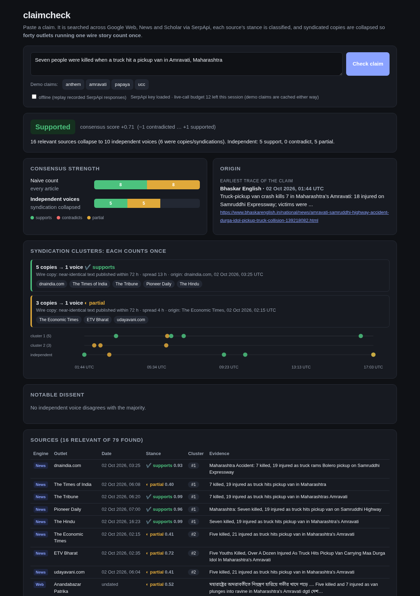
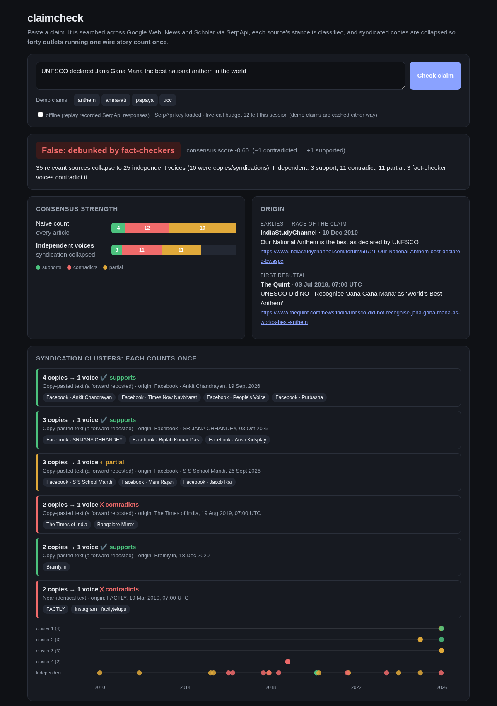
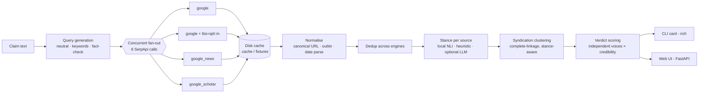

# claimcheck: who actually confirmed this?

**Paste a claim, get a verdict card that shows how many *independent* sources support or
contradict it, after collapsing wire copy and copy-pasted forwards.**

Built for the SerpApi India Hackathon 2026 · Track: **Knowledge & Public Interest (news literacy)**

```
$ claimcheck "Seven people were killed when a truck hit a pickup van in Amravati, Maharashtra"

 Supported   consensus score +0.71
 16 relevant sources collapse to 10 independent voices (6 were copies/syndications).

                                              ✔ supports  ✘ contradicts  ◐ partial
 Naive count (every article)                          8              0          8
 Independent voices (syndication collapsed)           5              0          5

 Syndication clusters: each counts once
  1  5 copies  ✔ supports  wire copy, spread 13h   dnaindia, Times of India, Tribune, Pioneer, The Hindu
  2  3 copies  ◐ partial   wire copy, spread 4h    Economic Times, ETV Bharat, Udayavani   ("Five killed, 21 injured")
```

| Web UI: wire story collapsed | Web UI: hoax, copy-paste forwards collapsed |
|---|---|
|  |  |

**Demo video:** _link added after recording_

## Why this exists

Forwarded claims in India travel faster than corrections. The usual check is "search it
and see how many sites say so", and that check has a blind spot: **forty outlets agreeing
means very little if thirty-nine of them ran the same PTI wire copy**. The same holds when
"lots of people posted it" turns out to be one WhatsApp forward pasted onto Facebook and
Brainly for a decade.

claimcheck makes that structure visible. For any factual claim it shows:

| On the card | What it means |
|---|---|
| **Consensus strength** | supporting vs contradicting sources, counted twice: naively, and as **independent voices** after syndication is collapsed |
| **Earliest trace / first rebuttal** | when the claim first shows up in results, and when it was first contradicted, with links |
| **Syndication clusters** | "these 5 articles are one wire story", with the rule that grouped them, the time spread and the origin |
| **Notable dissent** | independent voices that disagree with the weighted majority |
| **Per-source table** | engine, outlet, date, stance, confidence, cluster, one-line evidence snippet |

**Who benefits:** anyone handed a forward (family WhatsApp groups, students, teachers); newsroom
and fact-check desks deciding whether a story is "widely reported" or "widely copied";
researchers who want a quick read on whether the literature backs a health claim.

## How SerpApi is used (the engines, and why each one)

claimcheck needs several engines to work at all. Each claim produces a fixed plan of
**6 SerpApi calls across 3 engines plus a date-restricted variant**, run concurrently
(`src/claimcheck/queries.py`):

| # | Engine | Query variant | Why this engine |
|---|---|---|---|
| 1 | `google` | the claim as typed | general web: blogs, government pages, Wikipedia, **social reposts of the forward itself** |
| 2 | `google` | keywords + "fact check" | Alt News, BOOM, Factly, Vishvas News, PIB Fact Check etc. rank for this phrasing |
| 3 | `google` + `tbs=qdr:m` | keywords, past month | is the claim circulating *right now*? (date-restricted search) |
| 4 | `google_news` | keywords | news outlets with **exact timestamps**: the raw material for wire-copy detection |
| 5 | `google_news` | keywords + "fact check" | news-indexed fact-check desks and corrections |
| 6 | `google_scholar` | keywords | peer-reviewed evidence, a population news and web search never reach |

The engines return largely different results. In the bundled demos, almost every relevant
source was found by exactly one engine. The "Found only here" column of the card shows this
per claim:

| Demo | Web | News | Scholar |
|---|---|---|---|
| UNESCO anthem hoax | 20 relevant (forwards, fact-checks) | 11 (fact-check desks) | 4 (papers *studying* the hoax) |
| Amravati crash | 4 | 12 (the wire cluster) | 0 |
| Papaya / dengue | 13 | 13 | 10 (trials and reviews) |
| Gujarat UCC | 18 (13 only here) | 9 (4 only here) | 1 |

Each engine contributes something specific. News carries the timestamps that syndication
detection depends on. Web carries the forward itself. Scholar settles health claims. The
date-restricted run tells "old hoax" apart from "new story".

**Credit discipline.** Every SerpApi response is cached to disk from the first call
(`.cache/serpapi/`, keyed by engine + params, API key scrubbed), a per-process cap stops
runaway usage (`CLAIMCHECK_MAX_LIVE_CALLS`, default 12 = two claims), and the four demo claims'
real responses are committed under `fixtures/serpapi/` so the whole demo replays offline.
The entire build used 25 searches of the 250-search free plan.

## Architecture



| Module | Job |
|---|---|
| `serp.py` | SerpApi client, content-addressed disk cache, offline mode, live-call cap, key scrubbing |
| `queries.py` | deterministic query variants + the engine plan (deterministic so cached replays match) |
| `fanout.py` | thread-pool fan-out; one engine failing never sinks the verdict |
| `normalize.py` | per-engine parsers → one `Source` shape; canonical URLs (strip AMP/utm/www); 6 date formats incl. "3 days ago" relative to the search time; fact-checker / social / low-trust detection; wire bylines |
| `stance.py` | supports / contradicts / partial / unrelated: pluggable backends (below) |
| `syndication.py` | the clustering (below) |
| `verdict.py` | voices, credibility weights, score, label, earliest trace, dissent |
| `cli.py`, `web.py`, `static/index.html` | the two interfaces |

### Stance classification

* **Default, no API key needed:** a local DeBERTa-v3 NLI cross-encoder
  ([`Xenova/nli-deberta-v3-xsmall`](https://huggingface.co/Xenova/nli-deberta-v3-xsmall), int8 ONNX, ~87 MB,
  CPU via `onnxruntime`, no PyTorch). It downloads once on first use. Premise = title + snippet,
  hypothesis = the claim. Raw NLI is wrapped in rules that matter for this domain:
  a keyword-relevance gate (an off-topic page cannot "contradict"); debunk phrasing
  ("FAKE ALERT", "did not declare"); **fact-checkers quoting the claim they check are never
  counted as support**; questions ("Did UNESCO…?") are only partial; and numeric conflicts
  ("Five killed" vs "seven killed") are partial.
* **Fallback:** a pure heuristic (relevance + cue phrases + numbers). It is used automatically
  if the model cannot be loaded.
* **Optional LLM:** if `ANTHROPIC_API_KEY`, `OPENAI_API_KEY` or `GEMINI_API_KEY` is set, one
  batched call classifies all relevant sources with a JSON schema; any failure falls back to the
  local backend. (Anthropic uses the official SDK: `uv sync --extra llm`.) This path is
  unit-tested with mocks only; it was not run live during the build.

`--stance auto|nli|heuristic|llm` picks explicitly.

## Syndication detection (the hard part)

Two outlets running the same wire copy are **one** confirmation, not two. claimcheck links two
sources when any of these fires (`syndication.py`):

1. **Wire copy:** headline/snippet similarity ≥ 0.60 **and** published within **72 h** of each
   other. If both carry the same agency byline (PTI, ANI, IANS, UNI, Reuters, AFP, AP) the bar
   drops to 0.45.
2. **Publisher network:** same registrable domain (e.g. `timesofindia.indiatimes.com` and
   `bangaloremirror.indiatimes.com`) and similarity ≥ 0.50.
3. **Copy-paste forward:** verbatim text (Jaccard ≥ 0.85) at **any** date. This is what a
   WhatsApp forward looks like on the open web.
4. **Undated pair:** if a date is missing, similarity ≥ 0.75.

Similarity is the max of token Jaccard and a length-guarded containment score over normalised
text: lower-cased, number words → digits ("Seven" = "7"), possessives and outlet suffixes
(" - The Hindu", " | Mumbai news") stripped. So *"7 killed, 19 injured as truck hits pickup
van in Maharashtra"* matches *"Seven killed, 19 injured as truck hits pickup van in
Maharashtra's Amravati"*.

Two guards keep the clustering honest:

* **Complete linkage.** A source joins a cluster only if it links to *every* member. Naive
  single-linkage chained hoax posts → fact-checks → other fact-checks into one 22-member blob
  on the anthem claim. Complete linkage splits it correctly.
* **Stance-aware.** A supporting and a contradicting source are never linked: a copy of a story
  cannot disagree with itself.

Each cluster becomes one **voice** with a confidence-weighted majority stance. Voices are then
weighted by kind (fact-checker 1.5, Scholar 1.3, news 1.0, web 0.8, social 0.4, low-trust
scraper 0.2), and the score is `(S − C) / (S + C + 0.5·P)` over weighted voices, from −1 to +1.

**What it finds on the demos (all real recorded SerpApi responses):**

* **Amravati crash (2 Oct 2026):** 16 relevant articles → 10 voices. One PTI cluster of 5
  outlets over 13 hours, and a *second* cluster of 3 carrying the earlier wire version,
  "Five killed, 21 injured". The toll was updated later in the day, and the card shows it.
* **UNESCO "best national anthem" (false):** the Facebook "confirmations" collapse into
  copy-paste clusters of the same forward, word for word: *"…declared as the BEST ANTHEM OF THE
  WORLD by UNESCO. Just few minutes ago."* Times of India and Bangalore Mirror's fact-check is
  one voice (same publisher). Verdict: **False: debunked by fact-checkers** (3 independent
  fact-checker voices). Earliest trace in results: 2010.
* **Papaya leaf / dengue platelets:** four Scholar results quoting the same trial collapse into
  one voice. Trials support a platelet effect, while fact-checkers reject the "cure" framing.
  Verdict: **Contested / mixed evidence**, which matches the real state of the evidence.
* **Gujarat UCC (2 Oct 2026, recorded live by the CLI):** 23 → 13 voices; a scraper site on a
  throwaway TLD with a wrong date is detected as low-trust and never chosen as origin.

48 unit tests cover this, 13 of them for syndication alone (`tests/test_syndication.py`).

## Setup

Requires [uv](https://docs.astral.sh/uv/). Python 3.12 is fetched by uv automatically.

```bash
git clone https://github.com/Vir-007/claimcheck && cd claimcheck
uv sync

# Offline demo: no API key, no SerpApi credits, uses the recorded responses
uv run claimcheck --list-demos
uv run claimcheck --offline --demo anthem
uv run claimcheck --offline --demo amravati
uv run claimcheck-web            # → http://127.0.0.1:8000  (tick "offline", click a demo)

# Live: any claim
echo 'SERPAPI_API_KEY=your_key' > .env
uv run claimcheck "Papaya leaf extract increases platelet count in dengue patients"
uv run claimcheck --account      # credits left (free call)
uv run claimcheck "…" --json     # machine-readable verdict

uv run pytest                    # 48 tests, offline (1 skips unless `uv sync --extra llm`)
```

The first run downloads the 87 MB NLI model from Hugging Face into `~/.cache/huggingface`. With
no network it falls back to the heuristic stance backend and still runs.

Environment variables: `SERPAPI_API_KEY`; `CLAIMCHECK_MAX_LIVE_CALLS` (default 12);
optional `ANTHROPIC_API_KEY` / `OPENAI_API_KEY` / `GEMINI_API_KEY` and `CLAIMCHECK_LLM_MODEL`;
`CLAIMCHECK_NLI_MODEL` to swap the NLI model.

## Limitations

* **Snippets, not articles.** Stance is judged from titles and snippets SerpApi returns; no page
  is fetched. Fast and cheap, but a snippet can miss the article's conclusion.
* **The local NLI model is small and English-only.** Non-Latin-script sources fall back to the
  heuristic. Headline-ese still trips it occasionally; the LLM backend is the upgrade path.
* **"Earliest" means earliest *in these results*,** not proof of origin, and dates are only as
  good as what the engines report (Scholar gives a year; social posts give "1 year ago").
* **Syndication thresholds are hand-tuned** on Indian news; very short headlines can't be
  compared reliably, and genuinely independent reports with near-identical headlines can be
  over-merged inside the 72 h window.
* **Wire detection is a regex.** "PTI" is also Pakistan's Tehreek-e-Insaf; a false byline match
  only lowers a threshold, but it can.
* **Credibility weights are fixed and visible,** not learned. A verdict card is an aid to judgement,
  not a replacement for it.

## Project facts

* Built fresh on 2026-10-03/04 for the hackathon. See [`submission/`](submission/) for the
  description, prior-work and AI-tools disclosures, and the demo video script.
* License: MIT.
